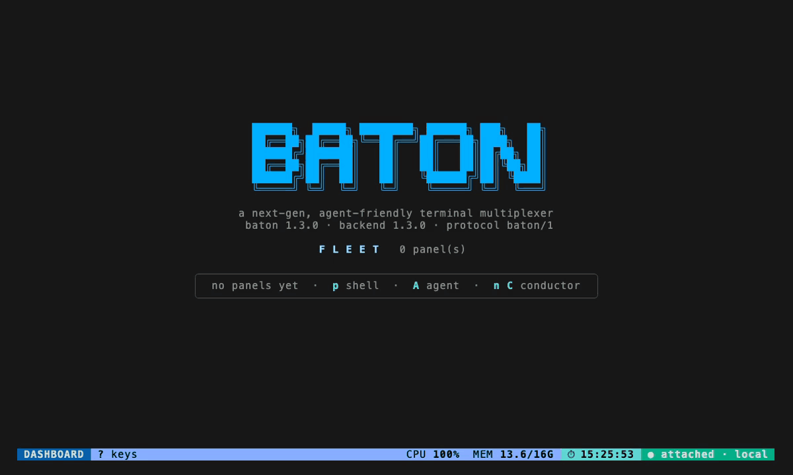

# Baton

> 확장 가능하고 agent 친화적인 터미널 멀티플렉서.

[](https://github.com/cmj0121/baton/releases/latest)
[](../LICENSE)
[](https://github.com/cmj0121/baton/actions/workflows/ci.yml)
[](https://codecov.io/gh/cmj0121/baton)

[English](../README.md) · [繁體中文](README.zh-TW.md) · [日本語](README.ja.md) · **한국어** ·
[Français](README.fr.md) · [Deutsch](README.de.md) · [Español](README.es.md)

AI 코딩 agent를 한 번에 여러 개 돌리면 상황은 금방 엉망이 됩니다 — 이리저리 옮겨 다녀야 하는 창들, 탭마다 흩어진
session, 그리고 누가 일하는 중이고 누가 막혔으며 누가 당신을 기다리는지 한눈에 볼 곳이 없죠. Baton과 AI agent의
관계는 tmux와 shell의 관계와 같습니다. **키보드만으로 조종하는 하나의 조종석**, 모든 agent를 자신이 속한 작업별로
묶어 보여 주는 실시간 대시보드, 그리고 어느 것이든 키 하나 거리. 지휘봉은 당신 손에 있습니다. agent들이 연주하고,
당신이 지휘합니다. 🎼



_`?`는 지금 서 있는 화면의 키를 보여 줍니다. 패널을 띄우고, `n C`로 conductor를 부르고, `g g` 다음 `g c`로 둘을
작업 항목으로 묶습니다 — 그리고 분할 화면의 `?`와 확대 화면의 `C-t ?`는 서로 다른 세 개의 표를 보여 줍니다._

## 시작하기

Baton은 단일 정적 실행 파일입니다. macOS에서는 `brew install cmj0121/tap/baton`, Linux에서는 다음 한 줄입니다.

```sh
curl -fsSL https://raw.githubusercontent.com/cmj0121/baton/main/scripts/install.sh | sh
```

…또는 [Go](https://go.dev) 1.26+ 로 `go install github.com/cmj0121/baton/cmd/baton@latest`. 그다음 `baton`을
실행하고:

1. **`A`** 로 agent를 띄웁니다(작업 디렉터리를 고릅니다. `enter`는 여기에 두고, `w` 는 브랜치로 격리합니다).
2. **`enter`** 로 확대해 일하는 모습을 지켜보고, **`C-t d`** 로 대시보드에 돌아옵니다.
3. **`q`** 로 분리(detach)합니다 — 모든 것은 계속 돌아갑니다. 언제든 `baton`으로 돌아오면 됩니다.

길을 잃었나요? **`?`** 는 지금 있는 화면의 키를 보여 줍니다. 함대 전체라면 **`n C`** 가
`$HOME/.baton/CONDUCTOR.md` 의 상설 지시를 따르는 conductor를 엽니다 — **[docs/CONTROL.md](CONTROL.md)** 참고.

## 개념

**panel**은 agent CLI나 shell이 돌아가는 하나의 라이브 터미널입니다. **work item**(작업 항목)은 한 작업의 패널들을
묶습니다. **task**는 agent에게 넘기는 브리프로, agent가 비어 있을 때까지 큐에 머뭅니다. **conductor**는 당신을
대신해 나머지 함대를 몰아 주는 agent입니다.

이것들은 세 가지 화면으로 봅니다. **대시보드**(모든 패널을 카드 또는 실시간 트리로), **그룹**(한 작업 항목의
패널들을 나란히 스트리밍), 그리고 **확대**(패널 하나가 당신의 유일한 터미널이 되고, 리더 키 `C-t`로 빠져나옴).
그 뒤에서는 헤드리스 서버가 Unix socket 너머로 모든 터미널을 소유하므로, 분리했다가 다시 붙어도 아무것도 잃지
않습니다. **[docs/SPEC.md](SPEC.md)** 참고.

## 왜 Baton인가

tmux는 창을 줄 뿐, 그 안에 무엇이 있는지 모릅니다. Baton은 모든 pane 안에 agent가 있다고 전제하고 거기서부터
쌓아 올립니다.

- **누가 당신을 필요로 하는지 보입니다.** 패널마다 살아 있는 상태가 있고, 사람을 기다리는 것들은 창을 하나씩
  넘겨 보며 찾는 대신 하나의 받은함에 줄을 섭니다.
- **일이 묶인 채로 유지됩니다.** 한 작업을 위한 패널들은 작업 항목이 되고, 키 두 번으로 만들어 하나처럼 몹니다.
- **키 입력이 아니라 일을 넘깁니다.** 브리프를 한 agent나 그룹 전체에 보내거나, conductor에게 함대를 맡기세요.
- **함대에는 한계가 있습니다.** 상한이 폭주하는 빌드의 프로세스 트리 전체를 붙잡고, 사용량은 그것을 쓴 패널까지
  추적됩니다.
- **함대는 기억합니다.** agent들이 거듭 배우는 것은 순위가 매겨져 다음 브리프에 건네집니다.

Baton은 당신의 shell을 원하지 않습니다 — tmux 안에서 살고 있다면 그 안에서 실행하세요.

## 기능

- **Attention** — 패널을 `running`, `idle`, `done`, `stuck`으로 줄 세우고, `C-t a`가 받은함. [ATTENTION](ATTENTION.md)
- **Conductor** — `n C`가 `baton ctl`이나 `baton mcp`로 함대를 몹니다. 호스트와는 울타리로 분리. [CONTROL](CONTROL.md)
- **Tasks** — `T`는 브리프를 agent나 작업 항목에 보내고, `Q`는 스케줄러가 비어 있는 agent에게 흘려보내는 백로그.
- **Score** — agent들이 거듭 배우는 것이 사다리를 올라 모든 브리프의 머리에 놓이며, `score.md`에 보관. [SCORE](SCORE.md)
- **Caps** — 패널의 프로세스 트리 전체에 걸리는 CPU·메모리·프로세스 수 상한. [LIMITS](LIMITS.md)
- **Usage** — `v u`는 토큰·비용·할당량 막대를, `v U`는 그것을 쓰는 패널을 보여 줍니다. [USAGE](USAGE.md)
- **Isolation** — `isolate: docker`면 프로필의 패널이 워크트리를 마운트한 컨테이너에서 돕니다. [ISOLATION](ISOLATION.md)
- **Fleet grep** — `/`는 모든 패널의 출력을 검색하고, `C-t [`는 OSC 52로 스크롤·복사 — SSH 너머에서도.
- **Backends** — `claude`, `codex`, `gemini`, `aider`, `opencode`, `grok`을 탐지하고, 직접 만든 것은 `panel.agents` 아래에.
- **Remote** — `baton --remote`가 당신의 ssh로 다른 머신의 함대에 붙습니다. [REMOTE](REMOTE.md)
- **Plugins** — Lua 파일 하나, `$HOME/.baton/plug-in.lua`가 이벤트에 훅을 걸고 명령을 더합니다. [PLUGIN](PLUGIN.md)
- **The usual** — diff(`D`), git 메뉴(`C-t G`), 시그널(`s`), 패널 로그, 시리얼 포트, 재시작 정책, 핫 리로드
  (`C-t R`), 테마와 분할 레이아웃.

## 필수 키

대시보드에서는 각 동작이 키 하나입니다. 확대 화면에서는 키 입력이 프로그램을 조작하므로 리더 키 `C-t`를 먼저
누르세요.

| 어디서      | 키            | 동작                                                  |
| ----------- | ------------- | ----------------------------------------------------- |
| Dashboard   | `jk` / `↑↓`   | 커서 이동                                             |
|             | `enter`       | 선택 항목 열기 / 확대                                 |
|             | `A`           | 새 agent — 작업 디렉터리 후 enter는 여기, `w` 는 격리 |
|             | `n C`         | conductor 열기(함대를 몰아주는 agent)                 |
|             | `g g` / `g c` | 표시 / 표시한 패널 묶기                               |
|             | `T` / `Q`     | 작업 배정 / 큐 관리                                   |
|             | `w` / `x x`   | 선택 항목 닫기 / 종료된 것 정리                       |
| After `C-t` | `d` / `b`     | 대시보드로 이동 / 한 단계 뒤로                        |
|             | `a`           | attention 받은함 — 사람이 필요한 것을 처리            |
|             | `q`           | 분리(서버는 계속 실행)                                |

그 밖의 모든 키는 `C-t k`로 다시 바인딩할 수 있으며, **[docs/KEYS.md](KEYS.md)** 에 있습니다.

## 문서

- **사용** — [SPEC](SPEC.md) · [KEYS](KEYS.md) · [ATTENTION](ATTENTION.md) · [TUI](TUI.md) ·
  [GIT](GIT.md) · [LOGGING](LOGGING.md)
- **함대** — [CONTROL](CONTROL.md) · [SCORE](SCORE.md) · [USAGE](USAGE.md) · [LIMITS](LIMITS.md) ·
  [ISOLATION](ISOLATION.md) · [RESTART](RESTART.md)
- **확장** — [PLUGIN](PLUGIN.md) · [REMOTE](REMOTE.md) · [SERIAL](SERIAL.md)
- **내부** — [DAEMON](DAEMON.md)

## DDD (Dream-Driven Development)

이 프로젝트는 DDD(꿈 주도 개발)를 따릅니다: 모든 기능은 내가 꿈꾸고 필요로 하는 것에서 만들어집니다.
